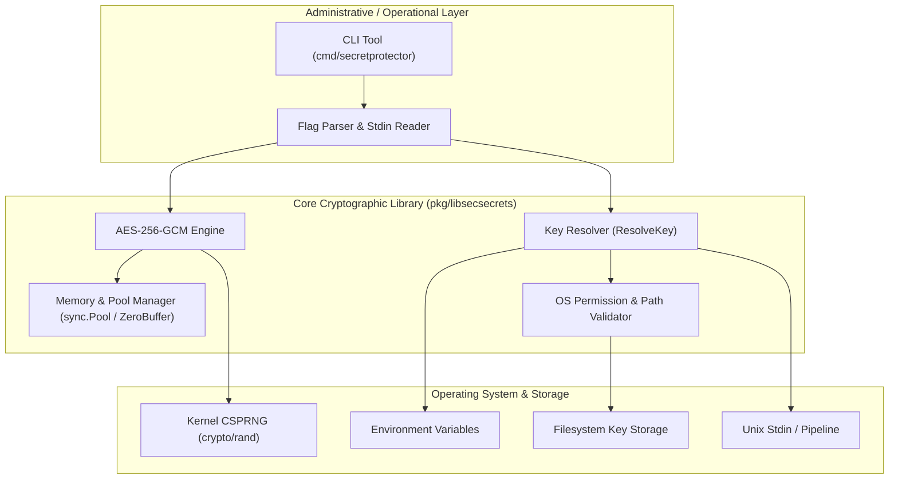
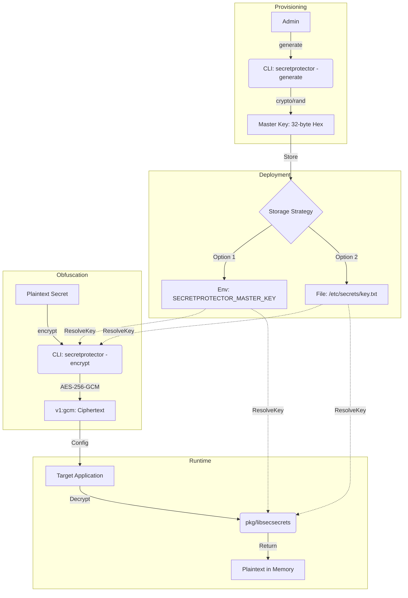
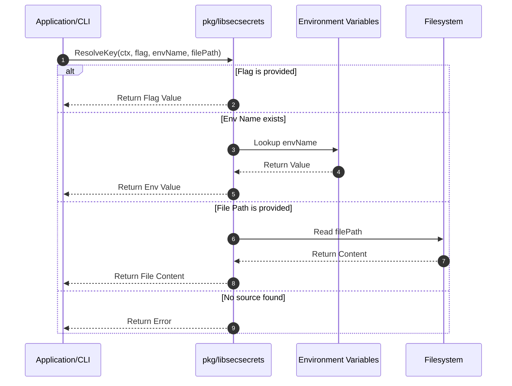
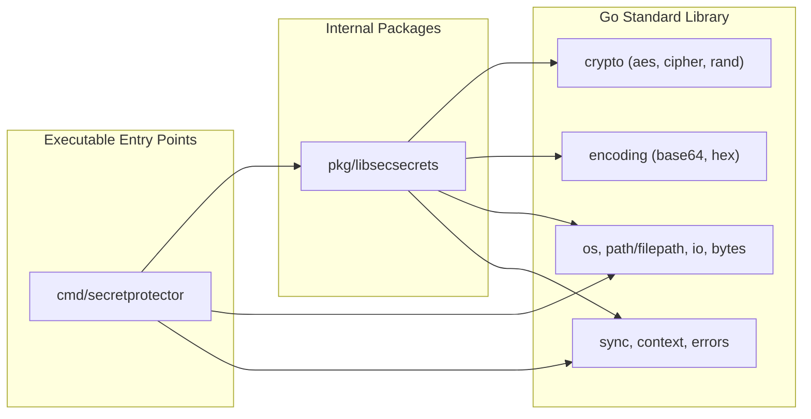
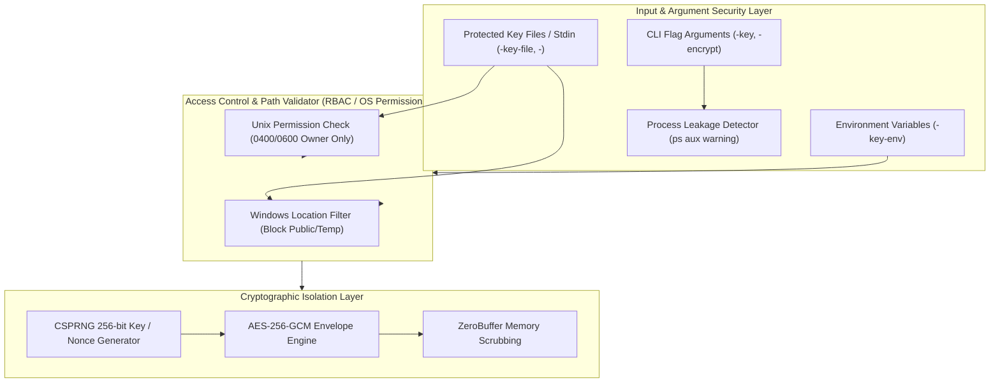

# Architecture & Design: SecretProtector

This document outlines the architectural decisions, design patterns, data flow, control logic and dependencies for the SecretProtector system.

## 1. System Overview

SecretProtector is a professional-grade secret management system designed to eliminate the storage of plaintext passwords on disk or in version control. It consists of three primary layers (using an SFTP client as a common example):
1.  **Core Library (`pkg/libsecsecrets`):** The cryptographic engine.
2.  **CLI Tool (`cmd/secretprotector`):** The administrative interface for key and secret management.
3.  **Application Layer:** Integration via a "Bootstrap" sequence for runtime decryption.

## 2. Architecture & Design Choices

### 2.1 Cryptographic Standard
- **AES-256-GCM (Galois/Counter Mode):** Chosen for authenticated encryption. It provides both confidentiality and integrity, ensuring that any tampering with the ciphertext or nonce will be detected during decryption.
- **Randomness:** Uses `crypto/rand` for cryptographically secure pseudo-random number generation (CSPRNG) for both 32-byte keys and GCM nonces.
- **Memory Security (Zeroing):** All sensitive buffers (Master Keys, Plaintext) are explicitly zeroed out after use using the `ZeroBuffer` utility to minimize the window of exposure in memory.

### 2.2 Package Structure
The project uses a standard Go layout:

```text
secretprotector
├── cmd/
│   └── secretprotector/
│       ├── main.go           # CLI Tool
│       ├── main_test.go      # Integration tests
│       └── e2e_integration_test.go # E2E binary tests
├── pkg/
│   └── libsecsecrets/
│       ├── libsecsecrets.go      # Core Logic
│       ├── libsecsecrets_test.go # Unit tests
│       ├── owner_unix.go         # Unix UID ownership check
│       ├── owner_unix_test.go    # Unix UID ownership tests
│       └── owner_windows.go      # Windows UID ownership stub
├── ARCHITECTURE.md           # Technical design
├── CHANGELOG.md              # Project changelog
├── DESIGN.md                 # Specification
├── README.md                 # User guide
├── SAMPLEAPP.md              # Developer integration guide
├── TESTING.md                # Test suite & coverage
└── go.mod
```

- `pkg/`: Internal library code that can be imported by other projects.
- `cmd/`: Entry points for executables.
- **Single Module:** All components reside in `github.com/edsilegxrepo/secretprotector` to ensure atomic updates and simplified dependency management.

### 2.3 Key Resolution Strategy
The system implements a hierarchical precedence model for Master Key resolution:
1.  **Direct Input (Flag):** Highest priority for temporary overrides or testing. Supports 64-character hex or 32-byte raw strings.
2.  **Environment Variable:** Standard for CI/CD pipelines and containerized environments. Supports 64-character hex or 32-byte raw strings (including 32-char printable Base64URL keys from `-generate-raw` / `GenerateRawKey`).
3.  **File Path:** Standard for on-premise deployments or hardware-backed secrets. Supports 64-character hex, 32-byte raw binary files (preserved exact without trimming), or 32-char Base64URL/raw text files (and stdin `-`).

### 2.4 Platform Security Boundaries
- **Linux/Unix:** Opens the key file once (`os.Open` + `f.Stat()`) to mitigate TOCTOU races, enforces regular-file type (`IsRegular()`), rejects special mode bits (`setuid`/`setgid`/`sticky`), verifies effective-UID ownership (`syscall.Stat_t.Uid == os.Geteuid()`), and enforces `0400` or `0600` permissions.
- **Windows:** Canonicalizes relative and symlinked/junction paths via `filepath.EvalSymlinks` before checking exact path-segment boundaries (`Public`, `Temp`, `tmp`) and temp directory prefixes.

### 2.5 Resource Management & Performance
- **Sync Pool Optimization:** The library utilizes `sync.Pool` for managing sensitive byte slices during hex key generation (`GenerateKey`). This reduces garbage collection (GC) overhead and ensures that buffers are securely zeroed via `ZeroBuffer` (`clear` + `runtime.KeepAlive`) before being returned to the pool. `GenerateKeyBytes()` returns 32 raw CSPRNG bytes for caller-managed zeroing, and `GenerateRawKey()` uses a scrubbed stack-local 24-byte buffer to emit a 32-char printable Base64URL key.
- **Context Propagation:** All primary API functions (`ResolveKey`, `Encrypt`, `Decrypt`, `EncryptBytes`, `DecryptBytes`, `EncryptWithAAD`, `DecryptWithAAD`, `EncryptBytesWithAAD`, `DecryptBytesWithAAD`) accept `context.Context` and guard `ctx.Err()` safely against `nil` contexts.
- **Custom Error Architecture:** Instead of generic errors, the system uses a structured set of exported sentinel errors (`ErrInvalidKey`, `ErrInsecureLocation`, `ErrNoKeySource`, `ErrInsecurePermissions`, `ErrCiphertextTooShort`, `ErrUnsupportedVersion`) to allow predictable programmatic handling via `errors.Is`.

### 2.6 System Assumptions
1.  **Entropy Boundary:** Master keys are 32 bytes (256-bit CSPRNG hex via `-generate` or `GenerateKeyBytes`, or 192-bit CSPRNG Base64URL raw via `-generate-raw` / `GenerateRawKey`) tailored for AES-256-GCM, with optional Additional Authenticated Data (AAD) binding via `*WithAAD`. Under NIST SP 800-38D guidance for random 96-bit GCM nonces, a single master key should not exceed $2^{32}$ encryptions before key rotation.
2.  **Kernel CSPRNG:** Operating system entropy sources (`/dev/urandom`, `RtlGenRandom`) are securely initialized by the OS kernel.
3.  **Local Access Control:** Host OS restricts local access to key files via user profiles/ACLs or owner-only permission bits (`0400`/`0600`).

### 2.7 Edge Cases & Resiliency
- **Stdin Collision Prevention:** Rejects simultaneous reading of both secret payload (`-encrypt -` / `-decrypt -`) and master key (`-key-file -`) from `os.Stdin` with diagnostic exit code `2` (`ExitUsageError`).
- **Bounded Reads & Line-Ending Hygiene:** Caps key-file/stdin reads at `4096` bytes (`maxKeyInputBytes`) and CLI stdin payloads at `10 MiB` (`maxStdinSecretBytes`), preserves exact 32-byte raw binary keys without truncating longer corrupted files, strips at most a single trailing `\r\n`/`\n` on text keys, and trims ciphertext whitespace via `bytes.TrimSpace`.
- **Insecure File Location & Symlink Canonicalization:** Resolves symlinks/junctions on Windows (`filepath.EvalSymlinks`) and rejects exact shared/temp path segments (`Public`, `Temp`, `tmp`) with `ErrInsecureLocation` / exit code `3` (`ExitKeyResolutionError`).

### 2.8 High-Level Architecture Diagram



## 3. Operational Workflow

1.  **Provisioning:** Admin runs `secretprotector -generate` to create a Master Key.
2.  **Deployment:** The Master Key is stored in an environment variable or a protected file.
3.  **Obfuscation:** Secrets (such as SFTP passwords, API keys, or DB credentials) are encrypted using the CLI and stored in configuration files as Base64 strings.
4.  **Runtime:** The application resolves the Master Key at startup, decrypts the secret into memory, and proceeds with the operation without ever writing the plaintext to disk.

## 4. Data Flow & Control Logic

### 4.1 Operational Flow
The following diagram illustrates the lifecycle of a secret, from master key generation to runtime decryption.



### 4.2 Key Resolution Sequence
The `ResolveKey` function implements the following priority logic:



## 5. Performance & Scalability

### 5.1 Concurrency Model
- **Stateless Lock-Free Execution**: All core cryptographic functions (`Encrypt`, `Decrypt`, `EncryptBytes`, `DecryptBytes`, `*WithAAD`) and production key resolution are stateless and lock-free. Internal unit and CLI tests inject isolated `sysDeps` / `cliDeps` dependency structs to run `t.Parallel()` without global mutable state or mutex contention.

### 5.2 Channel & Pipeline Structures
- **Bounded Stdin Streaming**: Key stdin reads (`-key-file -`) are bounded to `4096` bytes (`maxKeyInputBytes`), and CLI payload stdin reads (`-encrypt -`, `-decrypt -`) are bounded via `io.LimitReader` to `10 MiB` (`maxStdinSecretBytes`) to prevent unbounded memory allocation.

### 5.3 Memory Pool Management
- **Buffer Recycling**: `bytePool` (`sync.Pool`) manages temporary 32-byte buffers during random key generation, ensuring zeroed buffer recycling and reducing garbage collector overhead under heavy load.

## 6. Dependencies

### 6.1 Standard Library
The implementation relies exclusively on the Go standard library to minimize the attack surface and ensure maximum portability:
- `crypto/aes`, `crypto/cipher`: For encryption/decryption logic.
- `crypto/rand`: For secure random data.
- `encoding/hex`, `encoding/base64`: For data serialization.
- `os`, `flag`: For CLI interactions and system integration.
- `bytes`, `strings`, `sync`, `context`, `errors`: For memory hygiene, concurrency control, and diagnostic error handling.

### 6.2 External Dependencies
None. This project is intentionally designed with **Zero External Dependencies** to facilitate security audits and prevent supply-chain vulnerabilities.

### 6.3 Package Dependency Architecture



## 7. Security Architecture

### 7.1 Security Layers & Access Controls
1. **TOCTOU-Safe Single-Open Validation & RBAC (Unix/Linux):** Key files are opened once (`os.Open`) and validated on the handle via `f.Stat()` for regular-file type (`IsRegular()`), `<= 4096` bytes, no special mode bits (`setuid`/`setgid`/`sticky`), matching effective UID (`checkFileOwner`), and `0400` or `0600` permissions.
2. **Windows Security Boundary & Symlink Canonicalization:** Resolves symlinks/junctions via `filepath.EvalSymlinks` and rejects exact shared or volatile path segments (`Public`, `Temp`, `tmp`).
3. **Process Exposure Prevention:** Warns on `stderr` if sensitive secrets or keys are passed as CLI flags (which appear in process listings via `ps aux`). Prompts users to prefer environment variables (`-key-env`), key files (`-key-file`), or stdin (`-`).
4. **Optional Context Binding (AAD) & Version Isolation:** Supports `*WithAAD` functions to bind ciphertext to contextual metadata and returns `ErrUnsupportedVersion` on unknown `v<N>:<alg>:` headers.
5. **Structured Exit Diagnostics:** Returns distinct status codes (`0`, `2`, `3`, `4`, `5`) to allow SecOps monitoring without leaking error details.

### 7.2 Security Architecture Diagram


