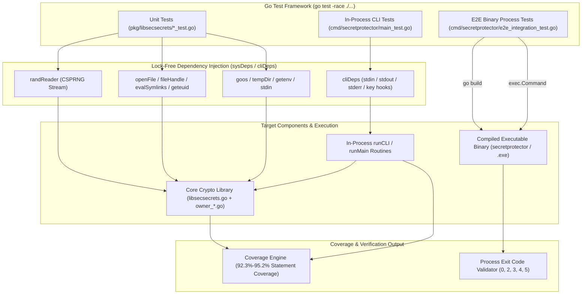
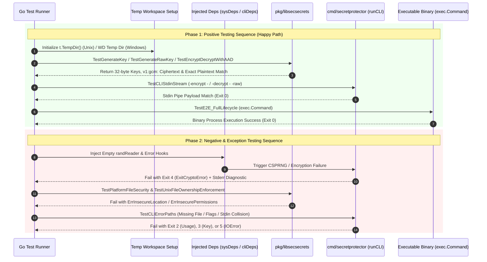

# Testing Strategy: SecretProtector

This document describes the testing architecture, design principles, coverage statistics, realistic data simulations, and execution procedures for the SecretProtector project.

---

## 1. Architecture, Design and Principles of the Test Suite

The test suite is engineered for **high-impact instrumentation**, **race-free parallelism**, and **dependency-injected isolation**, achieving **92.3%–95.2% statement coverage** across both Linux (WSL) and Windows while maintaining fast execution cycles under `go test -race ./...`.

### Key Architectural Principles
- **Dual-Layer Testing Architecture**:
  - **Unit & In-Process Integration Tests (`pkg/libsecsecrets`, `cmd/secretprotector/main_test.go`)**: Focus on cryptographic algorithm correctness, AAD binding, buffer zeroing, key resolution, and flag parsing via injected `sysDeps` and `runCLI(ctx, args, deps)` / `runMain(ctx)`.
  - **E2E Binary Process Integration Tests (`cmd/secretprotector/e2e_integration_test.go`)**: Compiles the actual `secretprotector` binary executable using `go build` and tests complete process lifecycles via `exec.Command`, verifying `-generate`, `-generate-raw`, `-raw`, stdin streaming, environment variables, and OS process exit codes (`0`, `2`, `3`, `4`, `5`).
- **Lock-Free Dependency Injection**: Both packages use unexported dependency structs (`sysDeps` in `pkg/libsecsecrets` and `cliDeps` in `cmd/secretprotector`) injected per call with no shared mutable globals or global mutex contention, allowing unit tests to run concurrently with `t.Parallel()` without triggering data races.
- **Zero External Test Dependencies**: Built exclusively with the Go standard `testing` package (no 3rd-party assertion or mocking frameworks), ensuring reproducible, supply-chain secure test runs.
- **Cross-Platform Simulation & Native Verification**: `sysDeps` models OS boundaries (`goos`, single-open `openFile`/`fileHandle`, `geteuid`, `evalSymlinks`, `tempDir`) so both Unix permission/UID rules (`0400`/`0600`, no setuid/setgid/sticky) and Windows path/junction protections can be unit-tested on any host, complemented by native OS tests on Windows and Linux (WSL) including `owner_unix_test.go` (`//go:build !windows`).

### 1.1 Test Suite Architecture Flowchart



---

## 2. Logic Flow of the Tests

The test suite is structured into two main logical testing paths:

### 2.1 Positive Testing Flow (Happy Path)
1. **Entropy & Key Generation**: Validates CSPRNG random key generation (`GenerateKey`, `GenerateRawKey`, and `GenerateKeyBytes`), ensuring 64-char hex, 32-char Base64URL, and 32-byte raw outputs plus `sync.Pool` buffer recycling.
2. **Cryptographic Round-Trips & AAD**: Validates AES-256-GCM authenticated encryption/decryption (`Encrypt`/`Decrypt`, `EncryptBytes`/`DecryptBytes`, `*WithAAD`), `IsEncrypted`/`IsEncryptedBytes` prefix detection, and `ZeroBuffer` scrubbing.
3. **Key Resolution Precedence**: Confirms that key resolution strictly honors priority hierarchy: `Flag (Direct)` > `Environment Variable` > `Protected File / Stdin` and preserves exact 32-byte binary keys including leading/trailing `0x20` bytes.
4. **Pipeline & Stdin Streaming**: Verifies bounded pipe ingestion (`maxCLIInputBytes` = `10 MiB`) for `-encrypt -`, `-decrypt -`, and `-key-file -` while preserving interior newlines.
5. **E2E Executable Lifecycle**: Compiles the real binary and executes full process lifecycle commands (`-generate`, `-generate-raw`, `-key-file`, `-raw`, `-key-env`, stdin pipelines), verifying stdout payloads and exit status `0`.

### 2.2 Negative Testing Flow (Failure Modes & Edge Cases)
1. **Entropy Exhaustion**: Injects an empty `sysDeps.randReader` and `cliDeps.generateKey`/`generateRawKey` error hooks to verify graceful handling of CSPRNG failure.
2. **Invalid Keys & Malformed Data**: Asserts immediate return of `ErrInvalidKey`, `ErrUnsupportedVersion`, and `ErrCiphertextTooShort` (minimum 28 bytes for nonce + GCM tag) for malformed keys, `v2:...` headers, or truncated payloads.
3. **MAC & AAD Tampering**: Asserts decryption failure when ciphertext, GCM tags, or AAD context strings are altered.
4. **Security Boundary Blocks**: Verifies single-open `fileHandle` enforcement of Unix modes (`0400`/`0600`), disallowed special bits (setuid/setgid/sticky), Unix owner UID matching (`owner_unix_test.go`), and Windows symlink/junction + exact directory-segment validation (`Public`, `Temp`, `tmp`).
5. **Stdin Collision, Bounded I/O & Exit Codes**: Verifies diagnostic exit codes (`ExitUsageError=2`, `ExitKeyResolutionError=3`, `ExitCryptoError=4`, `ExitIOError=5`) for bare invocations, mutually exclusive flags, stdin collisions, missing key files, and read/write I/O errors.

### 2.3 Logical Test Sequence Diagram



---

## 3. Technical Requirements and Setup

- **Go Version:** 1.25+ (`go 1.25.0` in `go.mod`, required for built-in `clear()` in `ZeroBuffer`).
- **Dependencies:** Standard Go library only (`testing`, `os`, `os/exec`, `path/filepath`, `runtime`, `bytes`, `strings`, `context`, `syscall` on Unix).
- **Environment Variables:**
  - `SECRETPROTECTOR_MASTER_KEY`: Used to test environment-based key resolution.
  - `TEMP` (Windows) / `TMPDIR` (Linux): Used for coverage profile storage and Unix `t.TempDir()` workspaces.
- **Constraints:**
  - Tests must not leave permanent file residue in the workspace. On Linux/Unix (including WSL), temporary key directories use `t.TempDir()` in native `/tmp` so POSIX `0600` permissions are enforced cleanly; on Windows, temporary key directories are created under `os.Getwd()` and removed via `t.Cleanup()` so Windows `%TEMP%` security blocks (`ErrInsecureLocation`) are not triggered unintentionally.

---

## 4. List of Tests

### 4.1 Cryptography & Memory Safety Tests (`pkg/libsecsecrets`)

| Test Name | Technical Purpose / Description | Success Criteria - Expected Result for PASS/FAIL |
| :--- | :--- | :--- |
| `TestGenerateKey` | Verify CSPRNG 64-char hex output format and `sync.Pool` allocation stability. | PASS: Returns valid 64-char hex key; distinct keys across calls. |
| `TestGenerateRawKey` | Verify CSPRNG 32-char Base64URL printable key generation and `ResolveKey` + `Encrypt`/`Decrypt` round-trip. | PASS: Returns valid 32-char Base64URL key; resolves to 32 bytes and round-trips cleanly. |
| `TestGenerateKeyBytes` | Verify raw 32-byte key slice generation and entropy-exhaustion error handling via `sysDeps`. | PASS: Returns 32 random bytes; fails cleanly when `randReader` is empty. |
| `TestIsEncrypted` | Verify `v1:gcm:` prefix detection (`IsEncrypted` / `IsEncryptedBytes`) across padded, bare, legacy, and plaintext inputs. | PASS: `true` for valid/whitespace-padded `v1:gcm:<payload>`; `false` otherwise. |
| `TestEncryptDecrypt` | Verify AES-256-GCM string encryption/decryption round-trip, empty strings, and legacy unprefixed Base64 decryption. | PASS: Decrypted plaintext string matches original input exactly. |
| `TestEncryptDecryptBytes` | Verify byte-slice crypto API and `bytes.TrimSpace` whitespace trimming. | PASS: Decrypted bytes match original; padded whitespace trimmed seamlessly. |
| `TestEncryptDecryptWithAAD` | Verify AAD context binding across `EncryptWithAAD`/`DecryptWithAAD` and `EncryptBytesWithAAD`/`DecryptBytesWithAAD`. | PASS: Succeeds with matching AAD; fails with mismatched or missing AAD. |
| `TestZeroBuffer` | Verify `ZeroBuffer` overwrites all bytes in sensitive buffers with `0`. | PASS: Every byte in the buffer equals `0x00` after scrubbing. |

### 4.2 Key Resolution Tests (`pkg/libsecsecrets`)

| Test Name | Technical Purpose / Description | Success Criteria - Expected Result for PASS/FAIL |
| :--- | :--- | :--- |
| `TestResolveKeyPrecedence` | Verify Flag > Env > File hierarchy and empty env source fallbacks. | PASS: Resolves correct key based strictly on source priority order. |
| `TestResolveKeyFileVariants` | Verify loading 64-char hex, exact 32-byte raw/binary (including `0x20`, `\x00`, `\n`), `GenerateRawKey` CRLF, and rejecting corrupted 33/34-byte files (`\r`, spaces, or non-printable bytes + `\n`/`\r\n`). | PASS: Decodes valid formats losslessly; rejects corrupted 33/34-byte payloads with `ErrInvalidKey`. |
| `TestResolveKeyStdin` | Verify loading master key directly from injected `sysDeps.stdin` and live `os.Stdin` pipe (`-key-file -`). | PASS: Successfully reads and resolves key from stdin pipe. |

### 4.3 Security & Platform Boundary Tests (`pkg/libsecsecrets`)

| Test Name | Technical Purpose / Description | Success Criteria - Expected Result for PASS/FAIL |
| :--- | :--- | :--- |
| `TestPlatformFileSecurity` | Verify Windows symlink/junction & exact segment blocks (`Public`, `Temp`, `tmp`, allowing `PublicAdmin`/`Template`) and Unix modes/types (`0400`/`0600`, no FIFO/dir/setuid/sticky). | PASS: Blocks insecure paths/modes with `ErrInsecureLocation` or `ErrInsecurePermissions`; permits safe paths/modes. |
| `TestUnixFileOwnershipEnforcement` | Verify (`//go:build !windows`) that single-open `fileHandle` rejects key files owned by another UID while permitting matching effective UID. | PASS: Mismatched UID returns `ErrInsecurePermissions`; matching UID resolves 32-byte key. |

### 4.4 Error Handling Tests (`pkg/libsecsecrets` & `cmd/secretprotector`)

| Test Name | Technical Purpose / Description | Success Criteria - Expected Result for PASS/FAIL |
| :--- | :--- | :--- |
| `TestErrorsAndEdgeCases` | Verify entropy exhaustion, invalid key lengths, `ErrUnsupportedVersion` (`v2:...`), `<28`-byte payloads, canceled/expired/nil contexts, bounded `4096`-byte reads, and open/stat/read errors. | PASS: Expected sentinel errors and `context` errors returned (`errors.Is`). |
| `TestExitErrorMethods` | Verify `exitError` helper methods (`Error()`, `Unwrap()`) and `exitCode()` mapping. | PASS: `exitCode` correctly maps `nil -> 0`, `exitError -> custom code`, `generic -> 1`. |

### 4.5 CLI In-Process Integration Tests (`cmd/secretprotector`)

| Test Name | Technical Purpose / Description | Success Criteria - Expected Result for PASS/FAIL |
| :--- | :--- | :--- |
| `TestMainCLI` | Verify CLI flag parsing (`-version`, `-generate`, `-generate-raw`, `-h`/`-help`) and bare no-args usage exit code `2`. | PASS: Correct output on stdout/stderr and exit `0` (`-h`) or `2` (bare invocation). |
| `TestRunMainSmoke` | Smoke-test `runMain(ctx)` OS stdio & `os.Args` wiring with `-version`. | PASS: Exits cleanly and prints build version to stdout. |
| `TestCLIEncryptionDecryption` | In-process integration flow using `-key`, env var, `-key-file` overriding ambient env, `-key-env` + `-key-file` priority/fallback, `-raw`, and CLI exposure warnings. | PASS: Transformations match `libsecsecrets` output; `-raw` omits trailing newline; `-key-file` beats ambient default env; explicit `-key-env` overrides `-key-file` when set and falls back when unset. |
| `TestCLIStdinStream` | Verify stdin pipeline streaming (`-encrypt -`, `-decrypt - -raw`) preserves interior newlines. | PASS: Seamless pipe data transformation and exact multiline plaintext recovery. |
| `TestCLIErrorPaths` | Verify CLI handling of unknown/extra/empty/exclusive flags, stdin collision, missing key file, crypto/entropy failures, and stdio write/read errors. | PASS: Returns exact exit codes (`2`, `3`, `4`, `5`) and stderr diagnostics. |
| `TestReadBoundedCLIAndLineTrimming` | Verify `readBoundedCLI` byte cap enforcement and CRLF/LF-only line-ending stripping (preserving standalone `\r`). | PASS: Rejects inputs exceeding limit; preserves standalone `\r`. |

### 4.6 End-to-End (E2E) Process Execution Tests (`cmd/secretprotector/e2e_integration_test.go`)

| Test Name | Technical Purpose / Description | Success Criteria - Expected Result for PASS/FAIL |
| :--- | :--- | :--- |
| `TestE2E_FullLifecycle` | Real-process binary execution of `-generate`, `-generate-raw`, key-file encryption/decryption (`-raw`), and env key resolution. | PASS: Binary exits 0; plaintext recovered accurately across process instances. |
| `TestE2E_StdinPipeline` | Real-process binary execution of stdin pipe streaming (`-encrypt -`, `-decrypt - -raw`), key-via-stdin (`-key-file -`), and multiline/non-ASCII/NUL byte preservation. | PASS: Binary exits 0; piped ciphertext and arbitrary payloads decrypt byte-for-byte cleanly via process stdin. |
| `TestE2E_ExitCodes` | Real-process binary verification of OS process exit codes (`0`, `2`, `3`, `4`, `5`), including real OS insecure key file rejection (`0o644` on Unix, temp dir on Windows). | PASS: Process exits with exact expected OS exit code matching specifications. |

---

## 5. Code Coverage Report

The SecretProtector test suite enforces strict code coverage standards exceeding the **>80%** mandatory requirement (target **>90%** across all packages).

### Current Up-to-Date Coverage Statistics (`v0.0.6`)

| Package | Linux (WSL) Statement Coverage | Windows Statement Coverage | Required Threshold | Status |
| :--- | :--- | :--- | :--- | :--- |
| `pkg/libsecsecrets` | **94.9%** | **95.2%** | >80.0% | **PASSED** |
| `cmd/secretprotector` | **92.3%** | **92.3%** | >80.0% | **PASSED** |

### How to Refresh Coverage Statistics

To run tests with race detection and refresh coverage statistics:

**Windows (PowerShell):**
```powershell
# Refresh library coverage stats
go test -race -v -coverprofile="$env:TEMP\libsecsecrets.cov" ./pkg/libsecsecrets; go tool cover -func="$env:TEMP\libsecsecrets.cov"

# Refresh CLI coverage stats
go test -race -v -coverprofile="$env:TEMP\secretprotector.cov" ./cmd/secretprotector; go tool cover -func="$env:TEMP\secretprotector.cov"

# Run full project race + coverage suite
go test -race -v -cover ./...
```

**Linux/Unix & WSL (Bash):**
```bash
# Refresh library coverage stats
go test -race -v -coverprofile="${TMPDIR:-/tmp}/libsecsecrets.cov" ./pkg/libsecsecrets && go tool cover -func="${TMPDIR:-/tmp}/libsecsecrets.cov"

# Refresh CLI coverage stats
go test -race -v -coverprofile="${TMPDIR:-/tmp}/secretprotector.cov" ./cmd/secretprotector && go tool cover -func="${TMPDIR:-/tmp}/secretprotector.cov"

# Run full project race + coverage suite (including owner_unix_test.go)
go test -race -v -cover ./...
```

---

## 6. Realistic Data Simulation

The test suite incorporates realistic data simulation to test against real OS environments, live stdin streams, and simulated system failures:
- **Live Binary Process Simulation (`exec.Command`)**: `e2e_integration_test.go` compiles the real `secretprotector` executable and spawns independent OS processes to test 100% of CLI functionality under production execution conditions.
- **Live Pipeline & Stdin Streaming (`os.Pipe()`)**: `TestCLIStdinStream` and `TestResolveKeyStdin` simulate live standard input stream ingestion via both `cliDeps`/`sysDeps` readers and `os.Pipe()` file descriptors.
- **CSPRNG Entropy Exhaustion**: Injects empty `sysDeps.randReader` and `cliDeps.generateKey`/`generateRawKey` hooks to verify clean failure handling during entropy exhaustion.
- **Filesystem Permission, UID & Path Boundaries**: Injects `sysDeps.openFile` (`fileHandle` + `mockFileInfo`), `evalSymlinks`, `geteuid`, `tempDir`, and `goos` to simulate Windows profile/junction paths (`C:\Users\Public`, `AppData\Local\Temp`) and Unix file modes/ownership (`0400`/`0600`, UID mismatch, setuid/sticky/FIFO) regardless of host OS.

---

## 7. How to Run the Tests

### Windows (PowerShell)
```powershell
# Run all project tests with race detector, verbose logging, and coverage
go test -race -v -cover ./...

# Run E2E process integration tests specifically
go test -v -run TestE2E ./cmd/secretprotector

# HTML coverage visualization in browser
go test -coverprofile="$env:TEMP\coverage.out" ./...; go tool cover -html="$env:TEMP\coverage.out"
```

### Linux/Unix & WSL (Bash)
```bash
# Run all project tests with race detector, verbose logging, and coverage
go test -race -v -cover ./...

# Or run Linux tests directly from Windows via WSL:
wsl --cd /mnt/e/data/devel/build/code/private/secretprotector bash -lc "go test -race -v -cover ./..."

# Run E2E process integration tests specifically
go test -v -run TestE2E ./cmd/secretprotector

# HTML coverage visualization in browser
go test -coverprofile="${TMPDIR:-/tmp}/coverage.out" ./... && go tool cover -html="${TMPDIR:-/tmp}/coverage.out"
```

---

## 8. Maintenance and Troubleshooting

- **Lint & Static Analysis Compliance**: Ensure `gofmt -l .` returns empty output and `go vet ./...` passes cleanly on both Windows and Linux before committing changes.
- **Maintaining >90% Coverage**: When modifying `ResolveKey`, `readProtectedKeyFile`, `validateWindowsKeyPath`, or `runCLI`, add corresponding unit and integration test cases to maintain >90% statement coverage.
- **Parallel Test Race Safety**: When writing parallel unit tests (`t.Parallel()`), always construct an isolated `sysDeps` (`newTestDeps()`) or `cliDeps` (`newTestCLIDeps(...)`) rather than mutating shared package-level variables.
- **Windows vs. Unix Permission & WSL Failures**: In tests targeting `readProtectedKeyFile`, set `sysDeps.goos` explicitly (`"linux"` vs `"windows"`) for simulated checks. For real key files written during tests on Linux/WSL over Windows DrvFs mounts (`/mnt/...`), use `t.TempDir()` on `/tmp` (handled automatically by `makeTempDirInWD`, `makeCLITestDirInWD`, and `makeE2ETempDirInWD`) so `0600` permissions are preserved natively.
