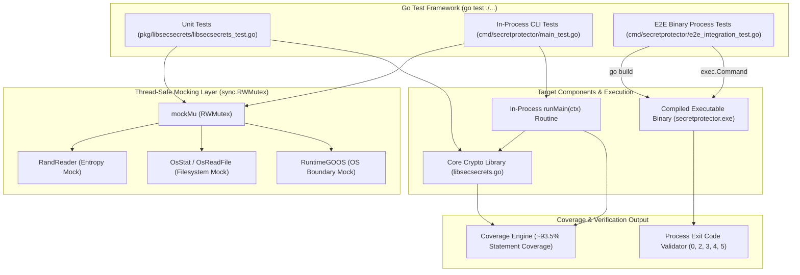
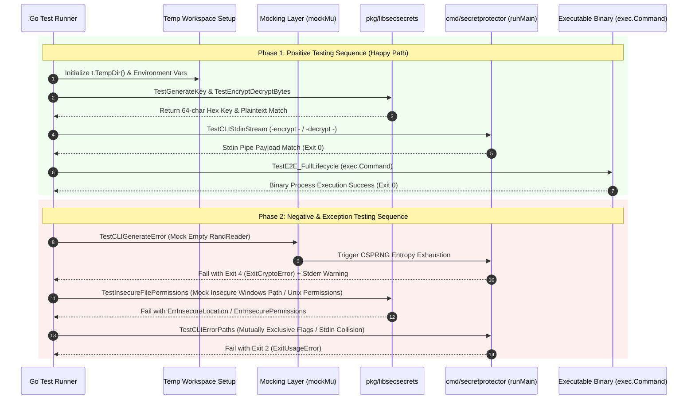

# Testing Strategy: SecretProtector

This document describes the testing architecture, design principles, coverage statistics, realistic data simulations, and execution procedures for the SecretProtector project.

---

## 1. Architecture, Design and Principles of the Test Suite

The test suite is engineered for **high-impact instrumentation**, **thread-safe parallelism**, and **comprehensive mocking**, achieving a statement coverage of **~93.5%** across the project while maintaining sub-second execution cycles.

### Key Architectural Principles
- **Dual-Layer Testing Architecture**:
  - **Unit & In-Process Integration Tests (`pkg/libsecsecrets`, `cmd/secretprotector/main_test.go`)**: Focus on cryptographic algorithm correctness, buffer zeroing, and flag parsing logic by refactoring CLI entry points into `runMain(ctx)`.
  - **E2E Binary Process Integration Tests (`cmd/secretprotector/e2e_integration_test.go`)**: Compiles the actual `secretprotector` binary executable using `go build` and tests complete process lifecycles via `exec.Command`, verifying stdin streaming, environment variables, and OS process exit codes (`0`, `2`, `3`, `4`, `5`).
- **Thread-Safe Mocking**: Mock getters (`getRandReader()`, `getOsReadFile()`, `getOsStat()`, `getRuntimeGOOS()`) are protected by an internal `sync.RWMutex` (`mockMu`), allowing unit tests to execute concurrently with `t.Parallel()` without triggering data races.
- **Zero External Test Dependencies**: Built exclusively with the Go standard `testing` package (no 3rd-party assertion or mocking frameworks), ensuring reproducible, supply-chain secure test runs.
- **Cross-Platform Simulation**: Includes logic to mock `RuntimeGOOS`, allowing Linux owner permission checks (`0400`/`0600`) and Windows root location restrictions (`C:\Users\Public`, `%TEMP%`) to be verified on any host operating system.

### 1.1 Test Suite Architecture Flowchart



---

## 2. Logic Flow of the Tests

The test suite is structured into two main logical testing paths:

### 2.1 Positive Testing Flow (Happy Path)
1. **Entropy & Key Generation**: Validates CSPRNG random key generation (`GenerateKey`), ensuring 64-character hex encoding and `sync.Pool` buffer recycling.
2. **Cryptographic Round-Trips**: Validates AES-256-GCM authenticated encryption/decryption (`Encrypt`/`Decrypt`, `EncryptBytes`/`DecryptBytes`), confirming exact recovery of plaintext bytes and string payloads.
3. **Key Resolution Precedence**: Confirms that key resolution strictly honors priority hierarchy: `Flag (Direct)` > `Environment Variable` > `Protected File / Stdin`.
4. **Pipeline & Stdin Streaming**: Verifies non-blocking pipe ingestion for `-encrypt -`, `-decrypt -`, and `-key-file -`.
5. **E2E Executable Lifecycle**: Compiles binary and executes real process lifecycle commands, verifying stdout payloads and status `0`.

### 2.2 Negative Testing Flow (Failure Modes & Edge Cases)
1. **Entropy Exhaustion**: Mocks `RandReader` with an empty reader to verify graceful handling of CSPRNG failure.
2. **Invalid Keys & Malformed Data**: Asserts immediate return of `ErrInvalidKey` for non-hex, wrong-length (not 32 bytes), or corrupted keys, and `ErrCiphertextTooShort` for truncated inputs.
3. **MAC Tampering**: Asserts decryption failure when ciphertext or MAC tags are altered.
4. **Security Boundary Blocks**: Verifies path canonicalization and blocks on unsafe permissions or insecure file locations.
5. **Stdin Collision & Flag Exclusivity**: Verifies return of `ExitUsageError` (`2`) when mutually exclusive action flags or dual stdin reads (`-encrypt - -key-file -`) are requested.

### 2.3 Logical Test Sequence Diagram



---

## 3. Technical Requirements and Setup

- **Go Version:** 1.21+
- **Dependencies:** Standard Go library only (`testing`, `exec`, `os`, `path/filepath`, `bytes`, `strings`, `context`).
- **Environment Variables:**
  - `SECRETPROTECTOR_MASTER_KEY`: Used to test environment-based key resolution.
  - `TEMP` (Windows) / `TMPDIR` (Linux): Used for coverage profile storage.
- **Constraints:**
  - Tests must not leave permanent file residue in the workspace; all temporary key files and binaries are created in system temp directories via `t.TempDir()` or cleaned up post-test execution.

---

## 4. List of Tests

### 4.1 Cryptography Tests (`pkg/libsecsecrets`)

| Test Name | Technical Purpose / Description | Success Criteria - Expected Result for PASS/FAIL |
| :--- | :--- | :--- |
| `TestGenerateKey` | Verify CSPRNG output format and `sync.Pool` allocation stability. | PASS: Returns valid 64-char hex key; subsequent pool reuse succeeds. |
| `TestEncryptDecrypt` | Verify AES-256-GCM string encryption/decryption round-trip with Context. | PASS: Decrypted plaintext string matches original input exactly. |
| `TestEncryptDecryptBytes` | Verify byte-slice crypto API and `bytes.TrimSpace` whitespace trimming. | PASS: Decrypted bytes match original; padded whitespace trimmed seamlessly. |

### 4.2 Key Resolution Tests (`pkg/libsecsecrets`)

| Test Name | Technical Purpose / Description | Success Criteria - Expected Result for PASS/FAIL |
| :--- | :--- | :--- |
| `TestResolveKeyPrecedence` | Verify Flag > Env > File hierarchy and empty source fallbacks. | PASS: Resolves correct key based strictly on source priority order. |
| `TestResolveKeyFileVariants` | Verify loading 64-char hex and 32-byte raw master keys from files. | PASS: Successfully decodes and resolves both 64-hex and 32-raw file formats. |
| `TestResolveKeyStdin` | Verify loading master key directly from standard input (`os.Stdin` / `-key-file -`). | PASS: Successfully reads and resolves 64-char hex key from stdin pipe. |

### 4.3 Security & Platform Boundary Tests (`pkg/libsecsecrets`)

| Test Name | Technical Purpose / Description | Success Criteria - Expected Result for PASS/FAIL |
| :--- | :--- | :--- |
| `TestInsecureFilePermissions` | Verify OS-specific path location blocks (Windows Public/Temp) and mode checks. | PASS: Returns custom `ErrInsecureLocation` or `ErrInsecurePermissions` error. |

### 4.4 Error Handling Tests (`pkg/libsecsecrets` & `cmd/secretprotector`)

| Test Name | Technical Purpose / Description | Success Criteria - Expected Result for PASS/FAIL |
| :--- | :--- | :--- |
| `TestErrors` | Verify library resilience, invalid key lengths, MAC failure, and custom error types. | PASS: Correct custom error types wrapped and returned (`errors.Is`). |
| `TestExitErrorMethods` | Verify `exitError` helper methods (`Error()`, `Unwrap()`) and `exitCode()` mapping. | PASS: `exitCode` correctly maps `nil -> 0`, `exitError -> custom code`, `generic -> 1`. |

### 4.5 CLI In-Process Integration Tests (`cmd/secretprotector`)

| Test Name | Technical Purpose / Description | Success Criteria - Expected Result for PASS/FAIL |
| :--- | :--- | :--- |
| `TestMainCLI` | Verify CLI flag parsing (`-version`, `-generate`) and default Usage output. | PASS: Correct version string or flag usage written to stdout/stderr. |
| `TestCLIEncryptionDecryption` | In-process integration flow using all key source flags. | PASS: Transformations match underlying `libsecsecrets` cryptographic output. |
| `TestCLIStdinStream` | Verify stdin pipeline streaming (`-encrypt -`, `-decrypt -`). | PASS: Seamless pipe data transformation and plaintext recovery. |
| `TestCLIErrorPaths` | Verify CLI handling of invalid/insecure inputs and diagnostic exit codes. | PASS: Returns differentiated status codes (`2`, `3`, `4`, `5`) and stderr warnings. |
| `TestCLIGenerateError` | Verify CLI behavior when entropy is exhausted during key generation. | PASS: Graceful failure message printed to stderr with exit code `4`. |

### 4.6 End-to-End (E2E) Process Execution Tests (`cmd/secretprotector/e2e_integration_test.go`)

| Test Name | Technical Purpose / Description | Success Criteria - Expected Result for PASS/FAIL |
| :--- | :--- | :--- |
| `TestE2E_FullLifecycle` | Real-process binary execution of key generation, key-file encryption, and env key resolution. | PASS: Binary exits 0; plaintext recovered accurately across process instances. |
| `TestE2E_StdinPipeline` | Real-process binary execution of stdin pipe streaming encryption/decryption. | PASS: Binary exits 0; piped ciphertext decrypted cleanly via process stdin. |
| `TestE2E_ExitCodes` | Real-process binary verification of OS process exit codes (`0`, `2`, `3`, `4`). | PASS: Process exits with exact expected OS exit code matching specifications. |

---

## 5. Code Coverage Report

The SecretProtector test suite enforces strict code coverage standards exceeding the **>80%** mandatory requirement (target **>90%** across all packages).

### Current Up-to-Date Coverage Statistics

| Package | Statement Coverage | Required Threshold | Status |
| :--- | :--- | :--- | :--- |
| `pkg/libsecsecrets` | **95.1%** | >80.0% | **PASSED** |
| `cmd/secretprotector` | **92.0%** (94.8% on `runMain`) | >80.0% | **PASSED** |
| **Total Project** | **~93.5%** | **>80.0%** | **PASSED** |

### How to Refresh Coverage Statistics

To run tests and refresh coverage statistics:

**Windows (PowerShell):**
```powershell
# Refresh library coverage stats
go test -v -coverprofile="$env:TEMP\libsecsecrets.cov" ./pkg/libsecsecrets; go tool cover -func="$env:TEMP\libsecsecrets.cov"

# Refresh CLI coverage stats
go test -v -coverprofile="$env:TEMP\secretprotector.cov" ./cmd/secretprotector; go tool cover -func="$env:TEMP\secretprotector.cov"

# Run full project coverage
go test -v -cover ./...
```

**Linux/Unix (Bash):**
```bash
# Refresh library coverage stats
go test -v -coverprofile="${TMPDIR:-/tmp}/libsecsecrets.cov" ./pkg/libsecsecrets && go tool cover -func="${TMPDIR:-/tmp}/libsecsecrets.cov"

# Refresh CLI coverage stats
go test -v -coverprofile="${TMPDIR:-/tmp}/secretprotector.cov" ./cmd/secretprotector && go tool cover -func="${TMPDIR:-/tmp}/secretprotector.cov"

# Run full project coverage
go test -v -cover ./...
```

---

## 6. Realistic Data Simulation

The test suite incorporates realistic data simulation to test against real OS environments, live stdin streams, and simulated system failures:
- **Live Binary Process Simulation (`exec.Command`)**: `e2e_integration_test.go` compiles the real `secretprotector` executable and spawns independent OS processes to test 100% of CLI functionality under production execution conditions.
- **Live Pipeline & Stdin Streaming (`os.Pipe()`)**: `TestCLIStdinStream` and `TestResolveKeyStdin` simulate live Unix standard input stream ingestion by creating `os.Pipe()` readers and writers.
- **CSPRNG Entropy Exhaustion**: Mocks `RandReader` with an empty reader to verify system behavior during hardware entropy failure.
- **Filesystem Permission & Path Boundaries**: Mocks `OsStat`, `OsReadFile`, and `RuntimeGOOS` to simulate Windows profile paths (`C:\Users\Public`) vs Unix file modes (`0400`/`0600`) regardless of host OS.

---

## 7. How to Run the Tests

### Windows (PowerShell)
```powershell
# Run all project tests with verbose logging and coverage
go test -v -cover ./...

# Run E2E process integration tests specifically
go test -v -run TestE2E ./cmd/secretprotector

# HTML coverage visualization in browser
go test -coverprofile="$env:TEMP\coverage.out" ./...; go tool cover -html="$env:TEMP\coverage.out"
```

### Linux/Unix (Bash)
```bash
# Run all project tests with verbose logging and coverage
go test -v -cover ./...

# Run E2E process integration tests specifically
go test -v -run TestE2E ./cmd/secretprotector

# HTML coverage visualization in browser
go test -coverprofile="${TMPDIR:-/tmp}/coverage.out" ./... && go tool cover -html="${TMPDIR:-/tmp}/coverage.out"
```

---

## 8. Maintenance and Troubleshooting

- **Lint & Static Analysis Compliance**: Ensure `go fmt ./...`, `go vet ./...`, and `golangci-lint run` pass cleanly before committing changes.
- **Maintaining >90% Coverage**: When modifying `ResolveKey`, `validateFilePermissions`, or CLI flag parsing logic, add corresponding unit and integration test cases to maintain >90% statement coverage.
- **Parallel Test Race Safety**: When writing parallel unit tests (`t.Parallel()`), always use `getRandReader()`, `getOsReadFile()`, `getOsStat()`, and `getRuntimeGOOS()` getters inside `libsecsecrets.go` to prevent data races on mock variables.
- **Windows vs. Unix Permission Failures**: If file permission tests fail on Windows host environments, verify that the `RuntimeGOOS` mock is set to `"linux"` or `"windows"` appropriately, as Windows filesystems handle access permissions via ACLs rather than Unix mode bits.
